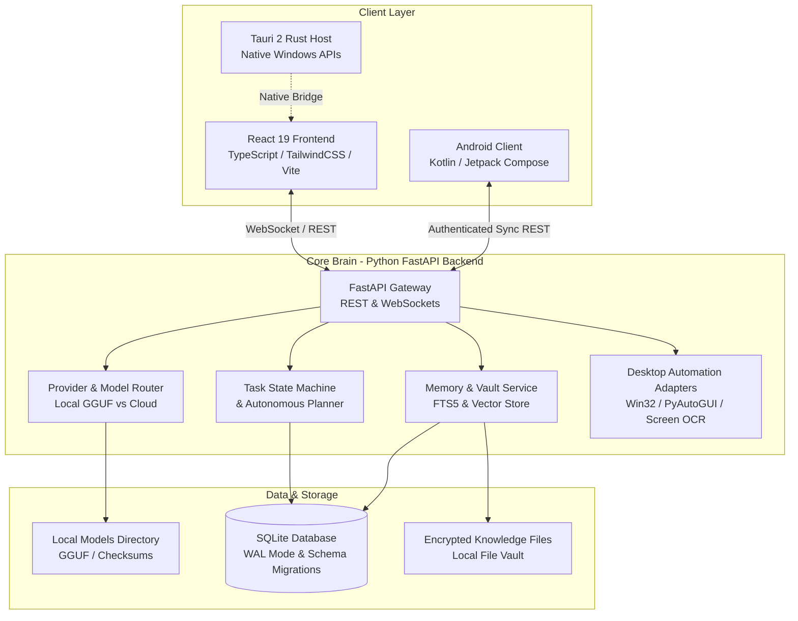
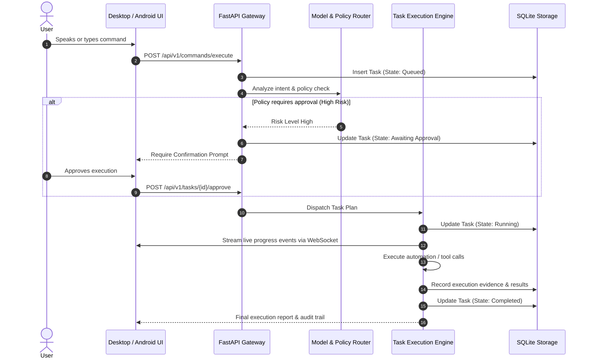
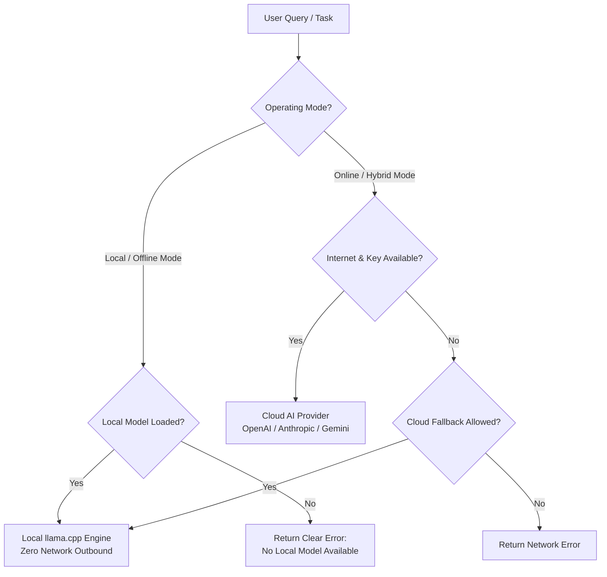
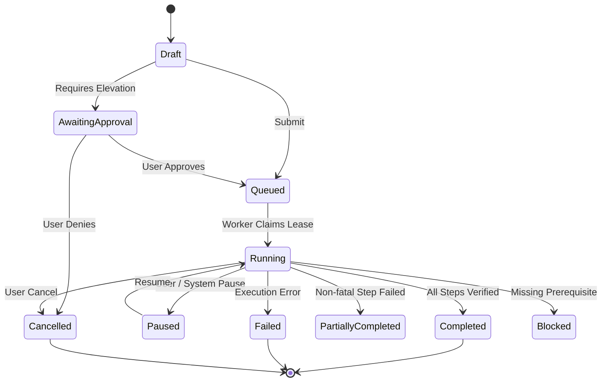

# ARCHITECTURE.md — System Architecture & Component Specifications

This document specifies the technical architecture, component boundaries, execution flows, and integration interfaces for **JARVIS**.

---

## 1. System Overview

JARVIS is architected as an asynchronous, local-first personal assistant with a decoupled tripartite runtime:
1. **Desktop Presentation & Container Layer:** React 19 + TypeScript encapsulated within a Tauri 2 (Rust) desktop shell.
2. **Core Brain & Service Layer:** Python 3.12 + FastAPI backend serving persistent business logic, task scheduling, local/cloud AI orchestration, and system automation adapters.
3. **Android Native Mobile Layer:** Kotlin + Jetpack Compose application with on-device local capabilities and authenticated synchronization with the shared brain.

---

## 2. Component Boundaries & Responsibilities

### 2.1 Desktop Client (`apps/desktop`)
- **Technology:** React 19, TypeScript (strict mode), Vite, Lucide Icons, Vanilla/Tailwind CSS design tokens.
- **Role:** High-performance responsive presentation layer hosting all 32 functional dashboard views, hologram audio visualization, real-time command feedback, and settings management.
- **State Management:** Lightweight React state with query caching for server resources, and WebSocket subscriptions for live task logs, voice waveforms, and health metrics.
- **Tauri Shell:** Provides minimal privileged native boundaries (system tray, window chrome, low-level hotkeys) without cluttering frontend logic.

### 2.2 Core Backend (`backend/src/jarvis`)
- **Technology:** Python 3.12, FastAPI, Pydantic v2, SQLAlchemy/aiosqlite.
- **Sub-modules:**
  - `api/`: REST endpoints and WebSocket handlers with explicit request/response schemas.
  - `core/`: Application lifecycle, settings loading, event bus, and structured logging.
  - `database/`: Database connection management, SQLite WAL mode configuration, and migration runner.
  - `models/`: SQLAlchemy ORM entity definitions.
  - `schemas/`: Pydantic validation models for all API boundaries.
  - `services/`: Encapsulated domain logic for Tasks, Memories, Vault, Providers, and Diagnostics.
  - `providers/`: Modular provider adapters:
    - `LocalEngine`: llama.cpp / GGUF runner for zero-API offline operation.
    - `CloudEngines`: OpenAI, Anthropic, Gemini, Groq, Ollama adapters.
  - `platform/`: Windows-specific native integrations (Win32 API, screen capture, OCR, audio I/O).
  - `automation/`: Browser automation (Playwright/Selenium), keyboard/mouse scripting, and app launcher.
  - `recovery/`: Local backup generation, cryptographic hashing, and restore operations.

### 2.3 Android Client (`apps/android`)
- **Technology:** Kotlin 2.x, Jetpack Compose, Room persistence, Coroutines & Flow.
- **Role:** Native Android companion providing voice interactions, device controls (contacts, alarms, notifications), accessibility-enabled UI automation, and secure sync with the JARVIS brain.
- **Single APK Requirement:** Self-contained build packaging native code, assets, and optional download manager for on-device MediaPipe/ML Kit runtimes.

---

## 3. Data Flow & Execution Pathways

### 3.1 Command Ingestion & Processing

### 3.2 Dual Operating Modes (Offline vs. Hybrid)

---

## 4. Task State Machine

Tasks are durable and strictly adhere to the state transition contract defined below:

---

## 5. Security & Isolation Boundaries

1. **Local-First Boundary:** All memories, user files, credentials, and conversation transcripts reside in local encrypted or access-restricted SQLite files.
2. **Zero-API Mode Guarantee:** When `JARVIS_OFFLINE_MODE=true` is enabled, the model router strictly disables outbound network calls to third-party AI endpoints.
3. **Approval Gates for Elevated Actions:** Desktop file deletions, OS command executions, and browser purchases require explicit interactive approval prompts.
4. **Audit Logging:** Every command execution, risk assessment, and tool invocation creates an immutable record in the `audit_logs` table.
