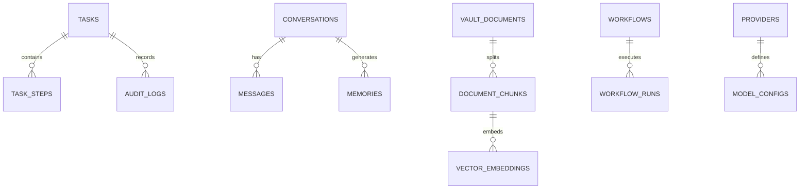

# DATA.md — Database Architecture, Entity Models & Persistence Specifications

This document defines the canonical relational and vector storage schemas, field definitions, indexing strategies, encryption boundaries, and migration policies for **JARVIS**.

---

## 1. Storage Engine & Database Design

- **Primary Database Engine:** SQLite 3.38+ with Write-Ahead Logging (`PRAGMA journal_mode=WAL;`).
- **Synchronous Mode:** `PRAGMA synchronous=NORMAL;` for high-throughput, crash-safe atomic transactions.
- **Foreign Key Constraints:** `PRAGMA foreign_keys=ON;` enforced on all sessions.
- **Full-Text Search:** SQLite `FTS5` virtual tables for full-text indexing across memories and vault documents.
- **Vector Search:** Embedded cosine similarity search module operating directly against serialized float vectors in SQLite or local index files.
- **Migration Engine:** Numbered linear migration scripts executed transactionally during backend boot.

---

## 2. Entity Relational Schemas



### 2.1 Table: `tasks`
Stores all top-level user and autonomous agent commands.

| Column | Type | Constraints | Description |
|---|---|---|---|
| `id` | TEXT (UUID) | PRIMARY KEY | Unique task identifier |
| `title` | TEXT | NOT NULL | Human-readable task description |
| `command_raw` | TEXT | NOT NULL | The original user input or trigger |
| `status` | TEXT | NOT NULL | Task state: Draft, Queued, Running, AwaitingApproval, Paused, Completed, PartiallyCompleted, Failed, Cancelled, Blocked |
| `risk_level` | TEXT | NOT NULL | Low, Medium, High, Critical |
| `requires_approval` | BOOLEAN | DEFAULT 0 | 1 if elevated confirmation prompt is mandatory |
| `approved_at` | DATETIME | NULL | Timestamp of explicit user approval |
| `progress_pct` | REAL | DEFAULT 0.0 | Normalized progress 0.0 to 100.0 |
| `device_id` | TEXT | NOT NULL | Executing device identity (e.g. `windows-desktop`, `android-mobile`) |
| `result_summary` | TEXT | NULL | Structured summary of final outcome |
| `error_details` | TEXT | NULL | Diagnostic failure information |
| `created_at` | DATETIME | NOT NULL | ISO8601 creation timestamp |
| `updated_at` | DATETIME | NOT NULL | ISO8601 last modified timestamp |
| `completed_at` | DATETIME | NULL | ISO8601 completion timestamp |

### 2.2 Table: `task_steps`
Discrete atomic action steps decomposed by the planner for a task.

| Column | Type | Constraints | Description |
|---|---|---|---|
| `id` | TEXT (UUID) | PRIMARY KEY | Unique step identifier |
| `task_id` | TEXT (UUID) | FOREIGN KEY -> tasks(id) ON DELETE CASCADE | Parent task |
| `step_order` | INTEGER | NOT NULL | Execution sequence index |
| `action_type` | TEXT | NOT NULL | e.g., `browser_open`, `ocr_scan`, `file_read`, `model_query` |
| `parameters` | TEXT (JSON) | NOT NULL | Serialized parameters for adapter |
| `status` | TEXT | NOT NULL | Pending, Running, Success, Failed, Skipped |
| `output_data` | TEXT (JSON) | NULL | Output payload or returned data |
| `started_at` | DATETIME | NULL | Execution start time |
| `finished_at` | DATETIME | NULL | Execution completion time |

### 2.3 Table: `memories`
Long-term semantic facts, episodic events, and persistent user context.

| Column | Type | Constraints | Description |
|---|---|---|---|
| `id` | TEXT (UUID) | PRIMARY KEY | Unique memory record identifier |
| `memory_type` | TEXT | NOT NULL | `fact`, `preference`, `episodic`, `project_context` |
| `category` | TEXT | NOT NULL | `user`, `system`, `coding`, `personal`, `device` |
| `content` | TEXT | NOT NULL | Canonical text content of memory |
| `source_ref` | TEXT | NULL | Reference ID (e.g., conversation ID or task ID) |
| `importance` | REAL | DEFAULT 1.0 | Salience weight (0.0 to 1.0) |
| `access_count` | INTEGER | DEFAULT 0 | Hit count for eviction / retention analysis |
| `is_sensitive` | BOOLEAN | DEFAULT 0 | 1 if encrypted with secret salt at rest |
| `created_at` | DATETIME | NOT NULL | ISO8601 timestamp |
| `last_accessed_at`| DATETIME| NOT NULL | ISO8601 timestamp |

### 2.4 Table: `vault_documents`
Catalog of local files ingested into the Knowledge Vault.

| Column | Type | Constraints | Description |
|---|---|---|---|
| `id` | TEXT (UUID) | PRIMARY KEY | Unique document identifier |
| `file_name` | TEXT | NOT NULL | Original base filename |
| `file_path` | TEXT | NOT NULL UNIQUE | Absolute local path on disk |
| `file_size_bytes` | INTEGER | NOT NULL | Size in bytes |
| `file_hash_sha256`| TEXT | NOT NULL | Cryptographic SHA-256 integrity hash |
| `mime_type` | TEXT | NOT NULL | e.g., `application/pdf`, `text/markdown` |
| `indexed_status` | TEXT | NOT NULL | `pending`, `indexing`, `indexed`, `failed` |
| `chunk_count` | INTEGER | DEFAULT 0 | Total partitioned text chunks |
| `created_at` | DATETIME | NOT NULL | Ingestion timestamp |
| `updated_at` | DATETIME | NOT NULL | Last indexed timestamp |

### 2.5 Table: `document_chunks`
Text slices extracted from vault documents for semantic and FTS search.

| Column | Type | Constraints | Description |
|---|---|---|---|
| `id` | TEXT (UUID) | PRIMARY KEY | Unique chunk identifier |
| `document_id` | TEXT (UUID) | FOREIGN KEY -> vault_documents(id) ON DELETE CASCADE | Parent document |
| `chunk_index` | INTEGER | NOT NULL | Sequence index within document |
| `chunk_text` | TEXT | NOT NULL | Extracted text chunk |
| `token_count` | INTEGER | NOT NULL | Approximated or exact token count |
| `embedding_blob` | BLOB | NULL | Serialized IEEE 754 float32 embedding vector |

### 2.6 Table: `providers` & `model_configs`
Configured local engines and cloud AI providers.

| Column | Type | Constraints | Description |
|---|---|---|---|
| `id` | TEXT | PRIMARY KEY | e.g., `local-gguf`, `openai`, `gemini` |
| `name` | TEXT | NOT NULL | Friendly display name |
| `provider_type`| TEXT | NOT NULL | `local_engine`, `cloud_api`, `ollama` |
| `is_enabled` | BOOLEAN | DEFAULT 1 | Active state flag |
| `is_local` | BOOLEAN | NOT NULL | 1 for zero-API offline engines |
| `endpoint_url` | TEXT | NULL | Base URL or host |
| `encrypted_api_key`| TEXT | NULL | AES-GCM encrypted API credential reference |
| `last_health_status`| TEXT | DEFAULT 'unknown'| `online`, `offline`, `degraded`, `error` |
| `last_checked_at`| DATETIME| NULL | Health ping timestamp |

### 2.7 Table: `audit_logs`
Immutable compliance and security trail for every executed tool or elevated action.

| Column | Type | Constraints | Description |
|---|---|---|---|
| `id` | INTEGER | PRIMARY KEY AUTOINCREMENT | Monotonic event sequence |
| `event_type` | TEXT | NOT NULL | `command_exec`, `approval_granted`, `approval_denied`, `file_shred`, `config_change` |
| `actor` | TEXT | NOT NULL | `user`, `autonomous_agent`, `scheduler` |
| `action_details`| TEXT (JSON) | NOT NULL | Redacted event parameters and target |
| `risk_level` | TEXT | NOT NULL | Low, Medium, High, Critical |
| `ip_or_origin` | TEXT | NOT NULL | `127.0.0.1` or device identifier |
| `timestamp` | DATETIME | NOT NULL | ISO8601 immutable timestamp |

---

## 3. SQLite Full-Text Search (FTS5)

To enable sub-millisecond keyword retrieval without external search daemons, FTS5 virtual tables index memories and document chunks:

```sql
CREATE VIRTUAL TABLE IF NOT EXISTS memories_fts USING fts5(
    content,
    category,
    content='memories',
    content_rowid='rowid'
);

CREATE VIRTUAL TABLE IF NOT EXISTS document_chunks_fts USING fts5(
    chunk_text,
    content='document_chunks',
    content_rowid='rowid'
);
```

---

## 4. Encryption & Security Boundaries

1. **Encrypted at Rest:**
   - Provider API keys and remote credentials (`providers.encrypted_api_key`) are encrypted using AES-256-GCM keyed by the local device key derived from `JARVIS_SECRET_SALT`.
   - Sensitive memory facts (`memories.is_sensitive = 1`) undergo transparent column-level encryption before writing to disk.
2. **Plaintext Local Data:**
   - General task logs, system telemetry, and non-sensitive knowledge files are stored in standard SQLite columns for instant querying and indexing.
3. **Data Shredding & Deletion:**
   - When a user deletes a memory or document, the record is immediately purged from SQLite and the associated FTS5 indexes are synchronized.
   - For sensitive documents, disk sectors are overwritten with zeros if supported by the file system before unlinking.

---

## 5. Backup & Recovery Rules

- **WAL Checkpoint:** Before taking a backup snapshot, execute `PRAGMA wal_checkpoint(TRUNCATE);` to ensure all transactions are flushed to the main `.db` file.
- **Atomic Online Backup:** Utilize SQLite Online Backup API (`sqlite3_backup_init`) to stream hot snapshots without blocking ongoing queries.
- **Manifest Tracking:** Every backup produces an accompanying `.manifest.json` containing table row counts, schema version, creation timestamp, and SHA-256 checksum.

---

## 6. Schema Version History

- **v1.0.0 (Phase 0/1 Baseline):** Initial schema defining `tasks`, `task_steps`, `memories`, `vault_documents`, `document_chunks`, `providers`, `model_configs`, and `audit_logs` tables.
