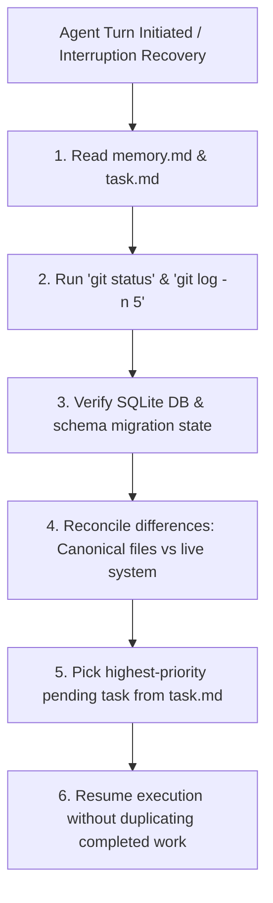

# WORKFLOW.md — Operational & Development Workflows

This document details the standard developer and automated agent workflows for developing, testing, building, recovering, and maintaining **JARVIS**.

---

## 1. Project Organization & Repository Topology

```text
jarvis/
├── apps/
│   ├── desktop/               # Desktop UI (React 19, TypeScript, Vite) & Tauri 2 Rust Shell
│   │   ├── src/               # React application source
│   │   │   ├── components/    # Reusable atoms & molecules
│   │   │   ├── pages/         # 32 functional dashboard pages
│   │   │   ├── services/      # REST & WebSocket API clients
│   │   │   ├── styles/        # Design tokens & glassmorphism theme
│   │   │   └── types/         # Strict TypeScript interfaces
│   │   └── src-tauri/         # Tauri 2 configuration, capabilities, and Rust native hooks
│   └── android/               # Native Android application (Kotlin, Jetpack Compose)
│       └── app/src/main/      # Compose UI, local storage, on-device AI integration
├── backend/                   # Core Python 3.12 + FastAPI brain
│   ├── src/jarvis/            # Modular Python backend package
│   │   ├── api/               # API routers (REST endpoints & WebSockets)
│   │   ├── core/              # Config, lifecycle, logging, events
│   │   ├── database/          # SQLite engine, migrations, session lifecycle
│   │   ├── models/            # SQLAlchemy database entities
│   │   ├── schemas/           # Pydantic v2 schemas
│   │   ├── services/          # Business logic engines (Tasks, Memory, Vault, etc.)
│   │   ├── providers/         # Local GGUF & cloud model adapters
│   │   ├── platform/          # Windows Win32, screen capture, OCR
│   │   └── recovery/          # Backup generation & restoration
│   ├── migrations/            # Versioned SQL migration files
│   └── tests/                 # Unit, integration, security, and offline test suites
├── scripts/                   # Cross-platform utility automation
│   ├── dev/                   # Local dev server launchers
│   ├── test/                  # Automated test runners
│   ├── build/                 # Desktop & Android packaging scripts
│   └── backup/                # Backup & recovery verification scripts
└── docs/                      # Architectural decision records & deep-dive technical specs
```

---

## 2. Environment Setup Workflow

### Step 1: Clone & Prerequisites
Ensure Python 3.12+, Node.js 20+, Git, and PowerShell are available in PATH.

### Step 2: Backend Virtual Environment
```powershell
cd backend
python -m venv .venv
.\.venv\Scripts\Activate.ps1
python -m pip install --upgrade pip
pip install -e ".[dev]"
```

### Step 3: Desktop Frontend Dependencies
```powershell
cd apps/desktop
npm install
```

### Step 4: Configuration Initialization
Copy the template configuration file:
```powershell
cp .env.example .env
```
Set `JARVIS_OFFLINE_MODE=true` to enforce local-only zero-API testing.

---

## 3. Development Workflow

### Concurrent Development (Backend + Frontend)
Run the backend server and frontend development server in parallel:

**Terminal 1 (Backend):**
```powershell
cd backend
.\.venv\Scripts\Activate.ps1
uvicorn jarvis.main:app --host 127.0.0.1 --port 8000 --reload
```

**Terminal 2 (Desktop Frontend):**
```powershell
cd apps/desktop
npm run dev
```

The frontend will run at `http://localhost:5173` and proxy API calls to `http://127.0.0.1:8000`.

---

## 4. Testing & Verification Workflow

Always verify before committing any feature:

### 4.1 Backend Test Execution
```powershell
cd backend
pytest tests/unit -v
pytest tests/integration -v
```

### 4.2 Frontend Static & Test Checks
```powershell
cd apps/desktop
npm run typecheck
npm run test
```

### 4.3 Database Schema Migration Verification
```powershell
cd backend
python -m jarvis.database.migrate check
```

---

## 5. Build & Packaging Workflows

### 5.1 Desktop Windows Installer (`JARVIS-Setup.exe`)
1. Compile the production frontend bundle:
   ```powershell
   cd apps/desktop
   npm run build
   ```
2. Build Tauri application bundle (requires Rust toolchain):
   ```powershell
   npm run tauri build
   ```
   Outputs standalone `JARVIS-Setup.exe` containing bundled web assets and local Python execution environment.

### 5.2 Android Single APK (`JARVIS.apk`)
1. Assemble release APK via Gradle:
   ```powershell
   cd apps/android
   ./gradlew assembleRelease
   ```
2. Outputs universal `JARVIS.apk` signed with the project release key.

---

## 6. Interruption & Context Recovery Workflow

If an agent or developer process is interrupted (e.g. system reboot, context switch, crash), follow the recovery protocol:



---

## 7. Documentation & State Synchronization Workflow

Whenever a meaningful change is completed:
1. Update `task.md` with execution evidence, files changed, and test outcomes.
2. Update `memory.md` to reflect the latest phase status, schema changes, and next action.
3. Update `CHANGELOG.md` with semantic release notes.
4. If an architectural decision was altered, record an ADR in `ADR/`.
5. Stage files and commit with conventional commit format:
   ```powershell
   git add <modified-files>
   git commit -m "<type>(<scope>): <summary>"
   ```
